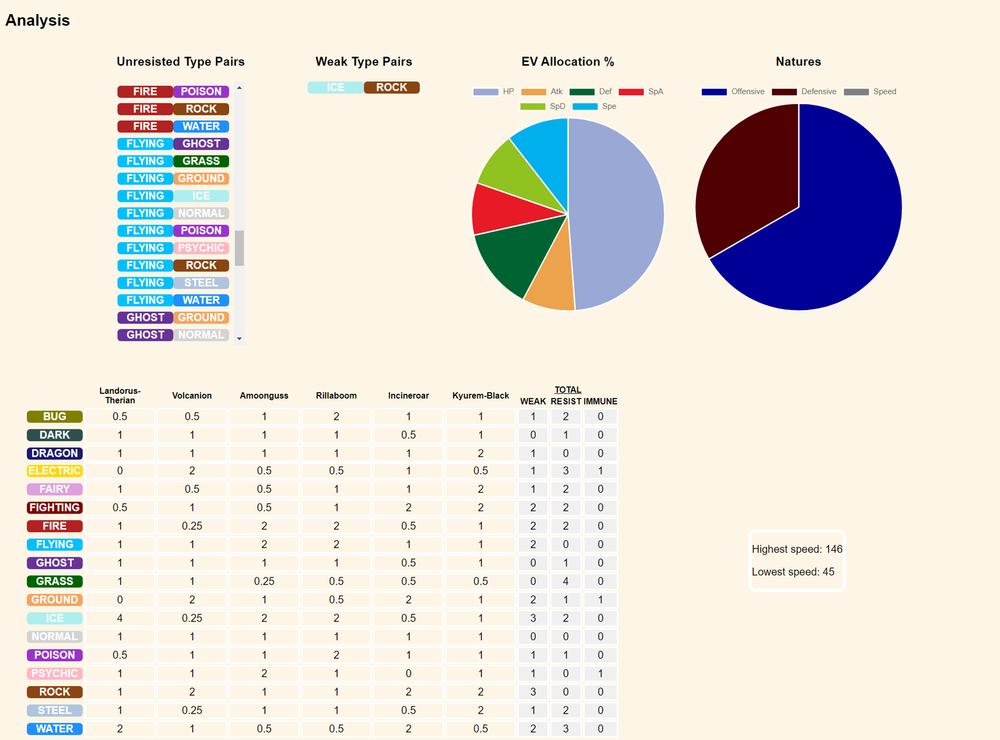

# Team Analytics Client

Frontend of a web application that analyses a Pokemon team. The user pastes a team, the client sends it to the server, and the analysis is displayed.

Server: https://github.com/DimK19/team-analytics-server



## What it does

- Takes a team of six Pokemon pasted in Pokemon Showdown export format.
- Parses the text into JSON (names, natures, EVs, IVs) and sends it to the server.
- Displays the result:
  - Unresisted and weak type pairs.
  - Pie charts of the team’s EV allocation and nature split.
  - A table of each member’s damage multiplier against every type, with weak, resist and immune totals.

## Technologies

- Angular 13 (TypeScript)
- Chart.js
- Express, to serve the built app on Heroku

## Running

```
npm install
npx ng serve
```

The app is served at `http://localhost:4200`.

The server URL is hard-coded in `src/app/team-form/team-form.component.ts`. To use a local server, change it to `http://localhost:3000/team`.

Production: `npm run build`, then `npm start` serves `dist/team-analytics-client` with Express.
